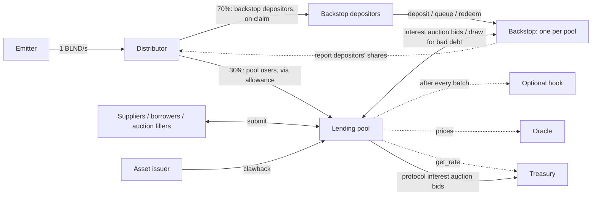

# Blend v3 protocol overview

> **Abstract.** Blend v3 is a protocol for isolated lending pools, built as Soroban smart contracts on Stellar. Anyone can deploy a pool with its own assets, parameters and price oracle. Every pool has its own backstop: capital that takes the first loss when a borrower defaults and earns a share of the pool's interest in return. A pool's positions, debts and losses never reach another pool. Interest rates adjust to each asset's demand on their own. Dutch auctions settle liquidations, bad debt and accrued interest. Emissions of BLND, the protocol's token, reward up to 30 pools whose standard backstops hold BLND–USDC liquidity. A capped share of borrower interest funds the protocol. No vote governs the protocol, and no core contract can be upgraded.

This document describes the whole protocol for a reader new to Blend. The [specifications](spec/) define each contract's interface. Blend's original design is in its [whitepaper](https://docs.blend.capital/blend-whitepaper).

## Contents

1. [Design](#1-design)
2. [System overview](#2-system-overview)
3. [Lending pools](#3-lending-pools)
4. [Backstops](#4-backstops)
5. [Auctions](#5-auctions)
6. [Protocol fee and treasury](#6-protocol-fee-and-treasury)
7. [BLND emissions](#7-blnd-emissions)
8. [Hooks](#8-hooks)
9. [Issuer controls and pool balances](#9-issuer-controls-and-pool-balances)
10. [Roles and trust](#10-roles-and-trust)

## 1. Design

Lending markets let suppliers earn interest from borrowers who post collateral. A market that keeps every asset in one pool has to vet each asset, because one bad asset can cost every supplier. Blend lets anyone deploy an isolated pool instead. A pool's positions, debts and losses stay in that pool, so a risky asset or a faulty oracle harms only the pool that chose it.

Isolation alone does not make an open pool safe to use. Every pool therefore has a backstop. Backstop depositors put up first-loss capital and receive a share of the pool's interest. Because they lose first, they have the strongest reason to watch the pool, and their withdrawals set its status. When enough of them queue to leave, the pool stops new borrowing and then new supply. No vote or operator is needed.

Four principles shape the design.

1. **Isolated first-loss capital.** One backstop per pool, holding one token, bound to that pool for life.
2. **Shared dependencies are opt-in.** A standard backstop holds the LP token of the protocol's BLND–USDC liquidity pool and can earn BLND emissions. A pool that wants neither deploys a custom backstop in a token of its choice and earns no emissions.
3. **Immutable core, composable edges.** No core contract can be upgraded. A pool adds its own rules through a hook, fixed when the pool is deployed.
4. **The protocol pays for itself.** A share of borrower interest, capped in code, funds maintenance and audits.

## 2. System overview

### 2.1 Contracts

| Contract | Role |
|---|---|
| Pool | An isolated lending market. It holds the reserves, the positions and the auctions. |
| Backstop | One per pool. It holds the pool's first-loss capital in one token and issues shares to depositors. |
| Pool factory | Deploys each pool, binds its backstop and records how it was deployed. |
| Treasury | Sets the protocol's share of interest, within a cap, and receives protocol interest auction bids. |
| Emitter | Mints 1 BLND per second to the distributor. |
| Distributor | Splits the BLND among the pools in the reward zone (§7.1) and pays it to their backstop depositors and users. |
| Hook | Optional, one per pool. The pool calls it after every batch of user actions, and it can reject the batch. |
| Oracle | One per pool, chosen at deploy. It prices the pool's assets. |

A solid arrow moves tokens. A dotted arrow is a call that moves none.



### 2.2 One interest payment, step by step

Suppose a borrower owes interest on a USDC loan in some pool.

1. Interest accrues to the USDC reserve whenever anyone touches it.
2. The pool splits the interest in USDC: the backstop's share at the pool's backstop take rate, the protocol's share at the treasury's rate, and the rest to the reserve's suppliers (§3.5).
3. A backstop interest auction sells the backstop's share. The filler pays in the backstop's token, which goes to the backstop and raises the value of every share (§5.4).
4. A protocol interest auction sells the protocol's share. The filler pays in the treasury's payout token, which goes to the treasury.

### 2.3 Deploying a pool

Anyone can deploy a pool through the factory. The deploy names the pool's admin, who must sign it. The pool's oracle, hook, backstop and `min_backstop` (§4.3) are fixed at deploy. The backstop take rate, `max_positions` and `min_collateral` (§3.3) can be changed later by the admin.

On the standard route the factory deploys the backstop from its own fixed code. On the custom route the admin deploys a backstop first, and the factory binds it after checking that it names the pool. The pool's address follows from the admin's address and a salt, so it is known before the pool exists. The factory writes the treasury, the distributor and the BLND token into every pool, so no deployer can choose their own. It records each pool with its backstop and its route. The distributor reads that record to decide which pools can earn emissions.

The factory has no admin and no setters. New pool code needs a new factory.

## 3. Lending pools

### 3.1 Reserves

A pool lends a set of assets, its reserves. The pool admin sets each reserve's parameters.

| Parameter | Meaning |
|---|---|
| `c_factor` | Collateral factor. The share of a collateral position's value that counts toward borrowing. |
| `l_factor` | Liability factor. A debt weighs on borrowing at its value divided by this factor. |
| `util` | Target utilization. The share of supply that the interest rate steers borrowing toward. |
| `max_util` | The utilization a borrow cannot push the reserve beyond. |
| `r_base`, `r_one`, `r_two`, `r_three` | The interest rate curve (§3.4). |
| `reactivity` | How fast the rate modifier moves (§3.4). |
| `supply_cap` | The most the reserve accepts in supply. |
| `enabled` | A disabled reserve takes no new supply and no new borrowing. Withdrawals and repayments still work. |
| `max_price_age` | The oldest oracle price the reserve accepts, in seconds. |
| `gulp_to_suppliers` | Whether a surplus of the asset (§9.3) goes to suppliers instead of backstop credit (§3.5). |
| `freeze_threshold` | The shortfall, as a share of the reserve's supply, that freezes the pool (§9.2). Zero never freezes. |

Supply and utilization caps limit what a pool can lose to an asset whose token or price fails.

Anyone can apply a change 7 days after the admin queues it, or at once while the pool is in setup (§3.7).

### 3.2 Supplying

A supplier deposits an asset and receives b_tokens, the amount divided by the reserve's `b_rate`. `b_rate` starts at 1 and rises as the suppliers' share of interest accrues, so every b_token is worth more over time. b_tokens are balances the pool records, not transferable tokens.

Supply comes in two kinds. Plain supply earns interest but cannot back a loan, and it cannot be liquidated. Collateral earns the same interest and counts toward borrowing.

### 3.3 Borrowing

A borrower receives the asset and takes on d_tokens, the amount divided by the reserve's `d_rate`. `d_rate` rises with every accrual of interest, so the debt grows. d_tokens cannot be transferred. They leave an account only through repayment, liquidation (§5.2) or the transfer of bad debt to the backstop (§5.3).

The health factor compares an account's weighted collateral with its weighted debt:

```math
HF = \frac{\sum_i V_i \, C_{f,i}}{\sum_j V_j \, / \, L_{f,j}}
```

where $V$ is a position's value at oracle prices, $`C_f`$ is the reserve's collateral factor and $`L_f`$ its liability factor. A batch that adds risk must leave the account with a health factor of at least 1.00001 and weighted collateral worth at least the pool's `min_collateral`. An account whose health factor falls below 1 can be liquidated.

Setting both factors per asset lets a pool allow different leverage for different pairs. With every stablecoin's factors at 0.98 and every volatile asset's at 0.765, a stablecoin loan against stablecoin collateral reaches 25x leverage. A volatile-asset loan against the same collateral reaches only 4x.

`max_positions` caps how many collateral and debt positions one account can hold.

Users act through `submit`, a batch of requests applied in order: supply, withdraw, supply or withdraw collateral, borrow, repay and auction fills. The pool checks health once, at the end of the batch. A flash loan sends an asset to a receiver contract before the batch's transfers settle. Only the final position must be healthy, so the loan needs no collateral up front.

### 3.4 Interest rates

Utilization $U$ is the share of a reserve's supply that is borrowed. Each reserve's rate follows a curve with three legs, set by its target utilization $`U_T`$ and four rate parameters:

```math
IR(U) =
\begin{cases}
RM \left(R_{base} + \frac{U}{U_T} R_1\right) & U \le U_T \\
RM \left(R_{base} + R_1 + \frac{U - U_T}{0.95 - U_T} R_2\right) & U_T < U \le 0.95 \\
RM \left(R_{base} + R_1 + R_2\right) + \frac{U - 0.95}{0.05} R_3 & U > 0.95
\end{cases}
```

$RM$, the rate modifier, makes the curve reactive. Each accrual moves it by the time elapsed times the distance from the target:

```math
RM_t = RM_{t-1} + \Delta t \, (U - U_T) \, k
```

where $k$ is the reserve's reactivity. $RM$ stays between 0.1 and 10. While borrowing runs above the target the rate keeps rising, and while it runs below the rate keeps falling. When rates elsewhere move, utilization returns to the target without anyone retuning the curve. The steep third leg makes the last 5% of supply expensive to borrow, which keeps liquidity available for withdrawals.

Interest accrues whenever a reserve is touched, over the seconds since it was last touched:

```math
\text{debt}_t = \text{debt}_{t-1} \left(1 + IR \cdot \frac{\Delta t}{\text{seconds per year}}\right)
```

### 3.5 Where interest goes

Each accrual splits a reserve's interest three ways, in the borrowed asset:

1. **Backstop credit**, at the pool's backstop take rate, set by the pool admin. A riskier pool needs a higher take rate to attract backstop deposits.
2. **Protocol credit**, at the protocol rate, read from the treasury at each accrual (§6).
3. **Suppliers**, the remainder, which raises `b_rate`.

Both rates are capped by constants in pool code, and the two caps together stay below 100%, so suppliers always keep a share. The split does not change what borrowers pay. The two credits stay in the pool, per reserve, until an interest auction sells them (§5.4).

### 3.6 Oracle

Each pool reads prices from one oracle, fixed at deploy, through SEP-40, Stellar's price-feed interface. The oracle must quote every price in USD. A price older than the reserve's `max_price_age` fails any action that needs it. A pool trusts its oracle. A wrong price can let an account borrow too much or get a healthy account liquidated, in that pool only.

### 3.7 Pool status

| Status | Supply | Borrow | Withdraw and repay |
|---|---|---|---|
| Active | yes | yes | yes |
| On ice | yes | no | yes |
| Frozen | no | no | yes |

A new pool starts in setup, where no one can supply or borrow and reserve changes take effect at once. The admin ends setup by setting a status.

From then on anyone can call `update_status`, which reads the backstop. The pool freezes when 60% or more of the backstop's shares are queued for withdrawal. It goes on ice when 30% or more are queued, or when the backstop holds less than `min_backstop`. Otherwise it is active.

The admin can set a status that `update_status` keeps, within limits:

| Admin sets | Allowed when | Ends when |
|---|---|---|
| Active | the backstop holds `min_backstop` and less than 50% of its shares are queued | either condition fails, and the pool goes on ice |
| On ice | less than 75% of the shares are queued | 75% are queued, and the pool freezes |
| Frozen | always | the admin lifts it |

A shortfall can also freeze the pool (§9.2).

## 4. Backstops

### 4.1 First-loss capital

Every pool has exactly one backstop, bound to it for life. The backstop holds one token, fixed when it is created, and only its pool can draw from it. Depositors receive shares, and a share's value moves with the backstop's holdings.

- **Interest raises it.** Backstop interest auctions pay the backstop in its own token (§5.4). Any plain transfer of the token to the backstop is a donation to all depositors.
- **Bad debt lowers it.** Bad-debt auctions draw the backstop's tokens to cover bad debt (§5.3).

The standard backstop is a tokenized vault under the ERC-4626 standard, built on OpenZeppelin's audited vault library. Its shares are SEP-41 tokens, Stellar's token interface, and can be transferred.

### 4.2 Withdrawal queue

A depositor in a standard backstop leaves in two steps. A redemption request moves the shares into escrow at the backstop for 17 days. After that the depositor can redeem them for tokens. A request can be cancelled at any time, which returns the shares. The queue follows ERC-7540's asynchronous redemption.

Queued shares stay exposed to the pool's gains and losses until they are redeemed, but they earn no emissions. The share of the backstop in escrow is what moves the pool's status (§3.7). No one can redeem while the pool holds bad debt against the backstop.

The backstop's capital cannot leave ahead of a loss depositors see coming, and their queue warns suppliers and borrowers by putting the pool on ice and then freezing it.

### 4.3 Activation

`min_backstop`, set at deploy in the backstop's own token, is the deposit the pool needs before it can be active. A pool may set it to zero. That removes the floor but not the backstop's role: whatever capital it holds is still sold to cover bad debt before any loss reaches suppliers.

### 4.4 Standard and custom backstops

The factory offers two routes, and the pool cannot tell them apart. Every backstop reports its token's price in USD, which the pool uses to size bad-debt and backstop interest auctions.

**Standard.** The backstop holds the LP token of the protocol's BLND–USDC pool on Comet, a weighted automated market maker. That pool holds 80% BLND and 20% USDC by value. The backstop prices its token from the Comet pool: the USDC behind one LP token, divided by USDC's 20% weight. Every standard backstop holds this one LP token, so a fault in that Comet pool impairs them all at once. Only standard backstops can earn BLND emissions (§7).

**Custom.** The pool admin deploys a backstop of their own, holding any token. It must offer what the pool calls: its token, its assets, its share supply, the shares queued in it, `draw`, its token's price and its pool. Beyond that its rules are its own, exits included. It may restrict deposits, apply share policies or use special custody. It never earns emissions, even if it holds the BLND–USDC LP token. The pool trusts what it reports and that it pays on `draw`. A wrong price mis-sizes that pool's auctions, and only that pool's.

## 5. Auctions

### 5.1 The auction curve

Every auction trades a lot, which the filler receives, for a bid, which the filler pays. All auctions follow one curve, counted in ledgers. A Stellar ledger closes about every 5 seconds.

- For the first 200 ledgers the bid stays at 100% and the lot grows by 0.5% per ledger, from 0% to 100%.
- For the next 200 ledgers the lot stays at 100% and the bid shrinks by 0.5% per ledger, to 0%.

The terms improve for fillers every ledger until someone fills, so the market sets the price, not a fixed penalty. A filler may take any percentage of an auction, and the rest stays open on the same curve. Partial fills let fillers with little capital take part.

### 5.2 Liquidations

Anyone can start a liquidation auction on an account whose health factor is below 1. The starter picks which debt and collateral positions to auction and the share of that debt, $`L_p`$. The pool sets the share of collateral in the lot, $`C_p`$, from the premium $p$ a liquidator can be expected to demand:

```math
p = 1 + \frac{1 - \bar{C}_f \, \bar{L}_f}{2}, \qquad C_p = \frac{p \, L_p \, L_o}{C_o}
```

where $`\bar{C}_f`$ and $`\bar{L}_f`$ are the average collateral and liability factors of the auctioned positions, $`L_o`$ is the value of the auctioned debt and $`C_o`$ that of the auctioned collateral. A partial liquidation must be sized so that, fully filled, it leaves the account with a health factor between 1.03 and 1.15. An account that a 95% liquidation would not lift above 1.15 can be liquidated in full. An account can have one liquidation auction at a time.

The filler takes the lot's collateral and the bid's debt into their own account and must end the batch healthy, so they usually repay the debt in the same batch.

### 5.3 Bad debt

A liquidation can leave an account with debt and no collateral. When the auction is fully filled, or when anyone calls `bad_debt`, that debt moves to the backstop, which takes it on as its own.

A bad-debt auction sells the backstop's tokens to cover it. The bid is the backstop's debt. The lot is backstop tokens worth 1.2 times that debt at the backstop's price, capped at what the backstop holds. The filler takes on the debt and receives tokens drawn from the backstop. Depositors bear the loss through a lower share value.

Only when the backstop is empty, or holds less than a small fraction of `min_backstop` fixed in pool code, is the remaining debt written off against the reserve's suppliers.

### 5.4 Interest auctions

Two auctions sell the credits interest leaves in the pool (§3.5).

| | Backstop interest auction | Protocol interest auction |
|---|---|---|
| Lot | backstop credit of the listed reserves | protocol credit of the listed reserves |
| Bid | the backstop's token | the treasury's payout token |
| Bid at the start | 1.2 times the lot's value | 1.2 times the lot's value |
| Bid goes to | the backstop | the treasury |

Anyone can start either auction once its lot is worth a minimum fixed in pool code. Each type runs one at a time per pool.

## 6. Protocol fee and treasury

The treasury is one contract for the whole protocol. Its owner sets the protocol rate, the share of borrower interest that becomes protocol credit (§3.5). The rate can never exceed a cap compiled into the pool. Every pool reads the rate at each accrual and applies it to all interest since the last one. The fee applies to every pool, whatever its backstop and its take rate.

The owner also names the payout token that protocol interest auctions take as their bid, with the oracle that prices it. Bids arrive at the treasury by plain transfer, and the treasury cannot block or alter a fill.

The owner can withdraw collected fees and transfer ownership. Ownership can be renounced only at a zero rate, which fixes the fee at zero for good. The fees fund maintenance and audits. The surplus is meant to buy back and burn BLND, so every pool supports BLND whether or not its backstop holds any.

## 7. BLND emissions

BLND is the protocol's token. The emitter mints 1 BLND per second to the distributor, which shares it out among the pools in the reward zone.

### 7.1 The reward zone

The reward zone holds up to 30 pools. A pool can enter only if:

- the factory deployed it on the standard route, and
- its backstop's holdings reach the admission threshold, a minimum set before deployment on a weighted product of the BLND and USDC behind its LP tokens.

When the zone is full, a pool enters by replacing one whose backstop holds less. Anyone can remove a pool whose backstop has fallen below the threshold. Zone changes must come within an hour of the last distribution. `min_backstop` plays no part in eligibility.

### 7.2 Distribution

Anyone can call `distribute`. The distributor collects the BLND minted since the last call and splits it across the zone, in proportion to each backstop's holdings outside the withdrawal queue. Once a day, anyone can split a pool's allotment:

- **70% to backstop depositors.** It is paid out evenly over the next 7 days to every share outside the withdrawal queue. Depositors claim it from the distributor, in BLND.
- **30% to the pool's users.** The distributor grants it to the pool as an allowance. The pool admin decides how it is shared among each reserve's suppliers and borrowers. It is paid out over 7 days, and users claim it from the pool.

A standard backstop reports every change in a depositor's shares to the distributor, which keeps each depositor's accrual.

### 7.3 Why emissions follow backstop size

Emissions keep a pool's backstop in step with its lending. A pool whose backstop grows faster than its lending earns more emissions for its users, which draws in supply and borrowing. A pool whose lending grows faster than its backstop pays its depositors more interest, which draws in deposits. Both forces keep each pool's first-loss capital in proportion to the funds it protects.

## 8. Hooks

A pool may bind one hook contract at deploy. The hook's address is fixed for the pool's life, published in the factory's deploy event and readable from the pool.

The pool calls the hook once at the end of every `submit` and every flash loan, after all requests have run, the health check has passed and the tokens have moved. No other pool function calls it. The hook receives the batch as submitted, every reserve the batch touched and the account's final positions. It rejects a batch by panicking, which reverts the whole transaction. It cannot change what the pool did. Amounts, accounting and transfers are the pool's, and Soroban stops the hook from calling back into the pool.

That is the only guarantee the core gives about a hook. Everything else is the hook's own code, which runs under the authorization the user signed. A hook can refuse any action, exits included, or charge a fee. A hook is therefore part of a pool's trust assumptions, like its admin and its oracle. Its code is public, the maintainers publish verified builds of known hooks, and the UI warns when a pool's hook is not one of them.

| Example policy | Rule |
|---|---|
| Allowlist | Every party to the batch must be on the hook's list. |
| Gated liquidators | Only listed addresses can fill auctions. |
| Supplier-only | Plain supply must come from one address, such as a vault that takes an operator's share of its depositors' interest. |

## 9. Issuer controls and pool balances

### 9.1 Clawback

Some Stellar assets let their issuer claw back balances. Through the pool, the administrator of an asset's Stellar Asset Contract, the contract form of a Stellar asset, can remove an exact amount of one holder's supplied position, plain supply first and collateral second, and burn the same amount from the pool's own holdings. In the same call the administrator can repay any of the holder's debts. The holder's position must end healthy. A clawback cannot recall tokens already lent out and never erases debt. It works only on an asset issued with that power. Pool admins and hooks have no such power.

### 9.2 Shortfalls

A pool can come to hold less of an asset than it owes, for example after an issuer claws back tokens directly from the pool's balance. Anyone can then call `reconcile`, which writes the shortfall off in order: first against protocol credit, then against the reserve's suppliers by lowering `b_rate`, then against backstop credit. A shortfall of at least the reserve's `freeze_threshold` also freezes the pool until its admin lifts the freeze.

### 9.3 Surplus

A pool can also come to hold more of an asset than it owes, for example after a transfer straight to the pool. While the pool is active, anyone can call `gulp` to add the surplus to backstop credit. A reserve with `gulp_to_suppliers` set credits it to its suppliers instead, by raising `b_rate`. That suits an asset that pays its yield in new tokens, as some tokenized funds do.

## 10. Roles and trust

| Role | Can | Cannot |
|---|---|---|
| Pool admin | Queue reserve changes, set the status within the limits of §3.7, change the backstop take rate under its cap, `max_positions` and `min_collateral`, split the pool's emissions among its reserves, hand over the role | Change the oracle, the backstop, the hook, the treasury, the distributor or `min_backstop`, or move anyone's funds |
| Treasury owner | Set the protocol rate under its cap, set the payout token and its price source, withdraw collected fees, transfer or renounce ownership | Exceed the cap, touch pool or backstop funds, redirect a fill |
| Asset issuer | Claw back one holder's position through the pool, repaying their debt in the same call | Recall lent-out tokens or erase debt |
| Hook | Reject any batch, and act under the authorization the user signed | Change what the pool did with a batch |
| Anyone | Deploy a pool, act in any pool, start and fill auctions, update a pool's status, move bad debt to the backstop, call `gulp` and `reconcile`, distribute emissions and update the reward zone within its rules | |

The pool, the standard backstop, the factory and the treasury have no upgrade function. A user of a pool trusts its admin within the limits above, its oracle, the issuers of its assets, its hook if it has one and, for a custom backstop, that backstop's code. Reserve changes wait 7 days, so users can leave before a change takes effect. A pool whose oracle or hook must change is replaced. Its backstop depositors queue to leave, which freezes the old pool.

Losses fall in the order of §5.3 and §9.2 and stay within the pool and its backstop.
