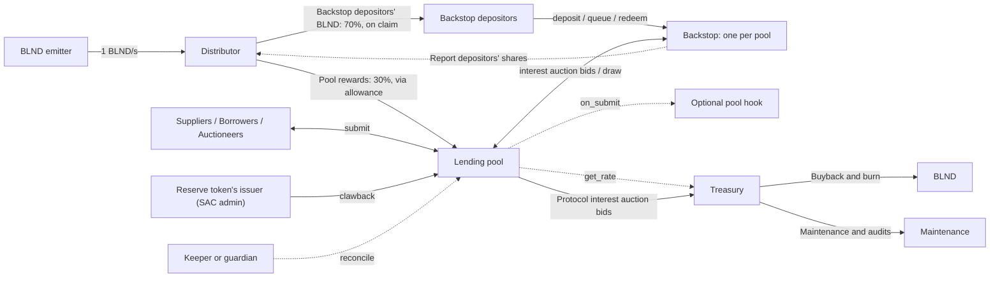
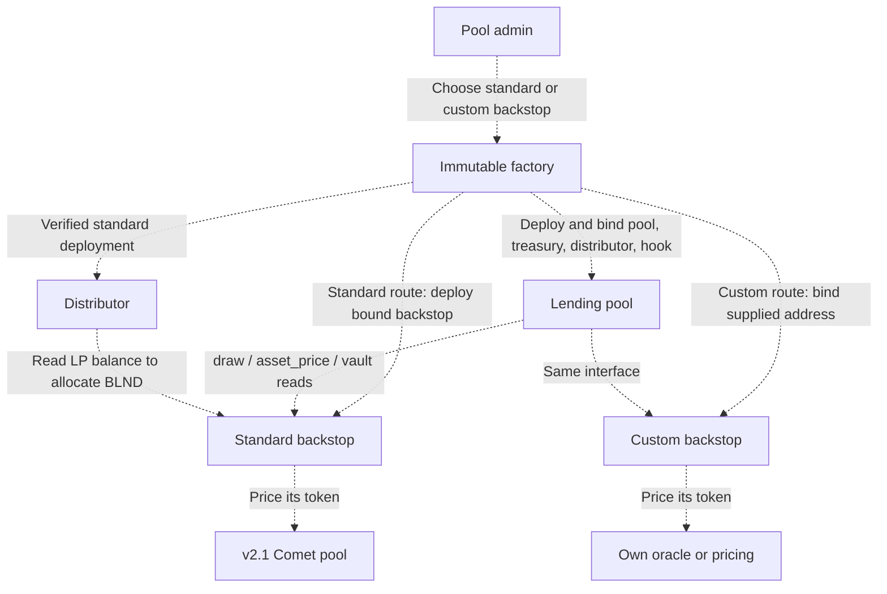

# Blend v3

**A proposal by Zenith Protocols and Xycloo**

| | |
|---|---|
| Status | Draft 0.1, internal |
| Date | 2026-10-08 |
| Authors | Zenith Protocols and Xycloo |
| Discussion | set at publication |

> **Summary.** Blend v3 keeps Blend v2's lending core and BLND, and changes what sits around them. Every pool gets its own backstop and chooses what it holds: a standard backstop keeps v2's model, holding the LP token of the Blend v2.1 BLND–USDC Comet pool and earning BLND emissions through a new distributor; a custom backstop holds a token of the pool's own choice and earns none. The shared backstop asset becomes a choice per pool instead of a rule for all. The protocol takes a capped share of borrower interest into a treasury that pays for maintenance and audits, with surplus proposed for buying back and burning BLND. Any pool can attach a hook, a contract fixed at deploy that enforces the pool's own rules on every action: an allowlist, a permissioned liquidator set, an operator fee, a lock-up, or whatever else the operator needs, without a change to the core. An asset's issuer can claw back one holder's position through the pool without breaking its accounting.

## What changes for you

| If you are a… | What changes | What stays |
|---|---|---|
| Supplier or borrower | A pool may attach a hook that enforces its own rules, such as an allowlist; the pool page shows which hook, if any (§3.5). Suppliers give up a small share of borrower interest to the protocol (§3.4). | Borrow rates, health factor, liquidations, auctions, the UI flow (§1.3). |
| Backstop depositor | Each pool has its own backstop contract (§3.1). A standard backstop holds the v2.1 Comet LP token and earns BLND, claimed from the distributor; a custom backstop holds the token its pool chose and earns none (§3.2, §3.3). | The 17-day withdrawal queue and the lever over pool status (§3.1). |
| BLND holder | Treasury surplus, after maintenance is funded, is proposed for buying BLND back and burning it. Pools with a custom backstop pay the same protocol fee into the same treasury, so every pool supports BLND whether or not it holds it (§3.4, §4). | The token, the emitter and the emission rate. No new token and no token swap; the emitter's one-time drop is an open question (§7). |
| Pool admin | You pick a standard or a custom backstop at deploy and an optional hook; both are fixed for the pool's life (§3.2, §3.5). You size the backstop's activation deposit, `min_backstop`, in the backstop token, at deploy (§3.1). The protocol fee applies to every pool, including one with a zero backstop take rate (§3.4). Only verified standard deployments earn emissions (§3.3). You set a maximum price age for each reserve (§3.7). | The admin levers from v2: reserve settings, status, backstop take rate. |
| Asset issuer (RWA, regulated stablecoins) | Allowlists, gated liquidators and rules on exits through hooks (§3.5). A targeted clawback through the pool removes one holder's position exactly (§3.6). | The issuer's powers over its own token are unchanged; the pool only learns to live with them. |
| Integrator or builder (SDK, UI, bots, products on a pool) | A new backstop ABI and SDK version; backstop emissions are claimed from the distributor (§3.1, §3.3). New treasury and distributor calls; one new auction to fill (§3.4). A hook lets a product set the rules of its own pool while the core stays audited and unchanged (§3.5). | The pool ABI for supply, borrow, repay, withdraw, auctions and flash loans (§1.3). |

## Contents

- [What changes for you](#what-changes-for-you)
- [1. Why a v3](#1-why-a-v3)
  - [1.1 What happened](#11-what-happened)
  - [1.2 What v3 answers](#12-what-v3-answers)
  - [1.3 What v2 got right and stays](#13-what-v2-got-right-and-stays)
  - [1.4 Design principles](#14-design-principles)
- [2. The design in one picture](#2-the-design-in-one-picture)
- [3. What changes](#3-what-changes)
  - [3.1 One backstop per pool](#31-one-backstop-per-pool)
  - [3.2 Standard and custom backstops](#32-standard-and-custom-backstops)
  - [3.3 Emissions through a distributor](#33-emissions-through-a-distributor)
  - [3.4 Protocol fee and treasury](#34-protocol-fee-and-treasury)
  - [3.5 Pool hooks](#35-pool-hooks)
  - [3.6 Issuer controls](#36-issuer-controls)
  - [3.7 Price age per reserve](#37-price-age-per-reserve)
- [4. BLND](#4-blnd)
- [5. Migration](#5-migration)
- [6. Security](#6-security)
- [7. Open questions](#7-open-questions)
- [8. Out of scope](#8-out-of-scope)
- [Appendix. Glossary](#appendix-glossary)

## 1. Why a v3

### 1.1 What happened

In August 2026 the Comet pool, the automated market maker holding the BLND–USDC liquidity behind Blend, was exploited through a bug in its swap logic. Every Blend v2 backstop holds the same asset, the LP token of that one Comet pool, so when the pool was drained every backstop in the protocol was impaired at the same time and interest auctions stopped. The bug is fixed in Comet v1.1, which Blend v2.1 runs on.

### 1.2 What v3 answers

What the incident showed is structural: v2 gives every pool the same backstop asset whether the pool wants it or not, because emissions needed one recipient and one ranking of pools. v3 keeps that model for the pools that want it, with its emissions, and lets any pool opt out by holding its own first-loss capital in a token of its choice. Making that possible without losing emissions is why v3 needs a distributor (§3.3). The incident also left the protocol without a funded maintainer, and nothing in v2 pays for one (§3.4). And a product built on a pool today has no way to set the pool's rules; hooks give it one (§3.5).

The YieldBlox oracle attack of February 2026 is not what v3 answers. Price quality is handled at the oracle layer, and that pool's loss stayed within that pool, as v2's per-pool backstop accounting already intended. v3 does not change how a pool is covered; it changes what the cover is made of, who pays for the protocol and what a pool may decide for itself.

### 1.3 What v2 got right and stays

The change is narrow because most of v2 is kept. The lending core stays: reserves with their interest-rate curves, the supply and debt accounting, the health factor, and the batch `submit` interface that bots and wallets already use. The auction design stays: user liquidations, bad-debt auctions and interest auctions all run as v2's Dutch auctions. Oracle handling stays: the pool reads prices through the same interface, and Script3's oracle aggregator can still sit in front of it. Reserve configuration stays: v2's parameters, queued with the same waiting period before a change takes effect. The withdrawal queue stays: a backstop depositor who wants out queues for 17 days, and the share of a backstop that is queued still drives the pool's status. BLND stays: the token, its emitter and its emission rate. The tooling stays: the SDK, the UI, the keeper and liquidation bots and the deployment checks carry over with the backstop module adjusted. Audit reports from two firms cover this code (§6).

One accounting change is stated where it is introduced: the protocol's share of accrued interest (§3.4).

### 1.4 Design principles

1. **Isolated first-loss capital.** One backstop per pool, holding one token, bound to that pool for life. One failure affects one pool.
2. **Shared dependencies are opt-in.** The standard backstop keeps v2's model: it holds the LP token of the Blend v2.1 BLND–USDC Comet pool and earns emissions. A pool that wants none of that dependency deploys a custom backstop in a token of its choice and forgoes emissions. The protocol does not force one asset on everyone.
3. **Immutable core, composable edges.** No upgrades in the pool, the backstop, the factory or the treasury. Extension happens through hooks and external contracts, set once at deploy.4. **The protocol pays for itself.** A share of borrower interest funds maintenance and audits. BLND keeps its token and its emissions, plus buybacks from treasury surplus.

## 2. The design in one picture

The diagram follows the money. A solid arrow moves tokens; a dotted arrow is a call that moves none. Terms are defined in [the glossary](#appendix-glossary).

**One borrower's interest payment, step by step.** Suppose a borrower owes interest on a USDC loan in some pool.

1. Interest accrues to the USDC reserve whenever anyone touches it, as in v2.
2. The interest is split per reserve, in its token: backstop credit at the backstop take rate, as in v2; `protocol_credit` at the protocol rate, the same way; the rest to suppliers (§3.4).
3. The backstop's share is turned into backstop tokens by an interest auction. A filler bids backstop tokens (the BLND–USDC LP token for a standard backstop, the pool's own choice for a custom one) for the accrued USDC. At fill the pool transfers the bid to the backstop. Every depositor's share is now worth more.
4. The protocol's share is sold the same way, in a protocol interest auction: a filler bids the treasury's payout token for the accrued USDC credit. At fill the bid goes to the treasury and the credit to the filler.

If the borrower instead defaults, the pool liquidates the position; what the collateral does not cover becomes bad debt, which is moved to the backstop and covered by selling backstop tokens in a bad-debt auction (§3.1).

| Contract | What it is |
|---|---|
| `pool` | v2's lending core, bound to its backstop, the treasury, the distributor and an optional hook; a per-reserve `protocol_credit` sold in protocol interest auctions. |
| standard `backstop` | One per pool, bound at deploy. Holds the LP token of the Blend v2.1 BLND–USDC Comet pool on OpenZeppelin vault math with v2's withdrawal queue; reports to the distributor. |
| `pool-factory` | Deploys a pool and its backstop as a bound pair from fixed code, or binds a supplied custom backstop; bakes the treasury and distributor addresses into the pool, so no deployer can choose their own. Records which route was used. |
| `distributor` | Receives the emitter's BLND and applies the reward-zone rules across separate backstops. |
| `treasury` | Holds the protocol rate, under the cap, names the payout token, and holds the collected fees. Owner-managed, ownership transferable. |
| hooks | Optional contract per pool, called after every batch. |

## 3. What changes

### 3.1 One backstop per pool

**Issue.** v2 has a single backstop contract for all pools. It keeps per-pool accounting, but every pool's first-loss capital is the same asset in the same contract: the LP token of one Comet pool. That design existed for emissions, which needed one recipient and one ranking of pools. When the LP token broke, every pool lost its cover and its interest auctions at once.

**Design.** Every pool gets its own backstop, deployed and bound by the factory. The backstop holds one token, fixed when it is created, and the pool is the only address that can draw from it. Share accounting uses OpenZeppelin's audited vault library, and a plain transfer of the backstop token into the contract is a donation to all depositors. v2's withdrawal queue is kept as it is: a depositor queues shares, waits 17 days, then redeems them. Depositors keep their lever over the pool: as more of a backstop is queued for withdrawal, the pool goes on ice and then freezes, at v2's thresholds. `min_backstop`, the deposit the pool needs before it activates, is set by the pool admin at deploy, in the backstop token itself; v2 had one protocol-wide activation formula. A pool may set it to zero, which removes the floor but does not waive a funded backstop's losses: whatever capital the backstop holds is offered before any bad debt is passed to suppliers. For bad-debt and interest auctions the backstop reports its own token's price through `asset_price`; the standard backstop derives it from the Comet pool. The backstop follows the ERC-4626 standard for tokenized vaults, with ERC-7540's asynchronous redemption in front of its exits. Queued shares are escrowed in the backstop; unqueued shares can be transferred, with earned rewards settled first. Specification: [spec/backstop.md](spec/backstop.md).

| If you are a… | What changes |
|---|---|
| Backstop depositor | You deposit into a separate backstop contract per pool. Unqueued shares are transferable. |
| Pool admin | You size `min_backstop` at deploy, in the token your backstop holds, and register for emissions on the distributor instead of the backstop. |
| Integrator | A new backstop ABI and SDK version. |

### 3.2 Standard and custom backstops

**Issue.** v2 gives every pool the same backstop asset whether the pool wants it or not. A pool for real-world assets may be forbidden from holding a volatile LP token; a pool that wants plain USDC cover has no route; and a protocol that pays emissions needs to know which backstops run code it can trust.

**Design.** The factory offers two routes and the pool cannot tell them apart. On the standard route the factory deploys a backstop from its fixed code hash; that backstop holds the LP token of the Blend v2.1 BLND–USDC Comet pool and is eligible for emissions. On the custom route the pool admin deploys a backstop that implements the same interface, holding any token and reporting its price through `asset_price`, with the pool's address in its constructor; the factory derives that address from the admin and a salt before the pool exists, deploys the pool at it, and checks that the backstop names it. Custom backstops may restrict deposits, apply share policies or use specialized custody. They never receive emissions, even if they hold the same LP token. The factory's records distinguish a recognized pool from a verified standard-backstop deployment, and the distributor reads those records. Specification: [spec/factory.md](spec/factory.md) and [spec/backstop.md](spec/backstop.md).

| If you are a… | What changes |
|---|---|
| Pool admin | Pick the route at deploy; the choice is permanent for that pool. |
| Backstop depositor | You deposit the token your pool's backstop holds: the v2.1 Comet LP for a standard backstop, the pool's chosen token for a custom one. |
| Asset issuer | The custom route lets your pool hold first-loss capital in a token your rules allow. |
| Integrator | The SDK covers the standard backstop and the interface every backstop exposes to the pool; a custom backstop's own functions and rules need their own integration. |

### 3.3 Emissions through a distributor

**Issue.** The emitter pays one recipient: in v2, the single backstop, which ranks pools in a reward zone and splits BLND between them. With one backstop per pool there is no single recipient, and the ranking must not be something a pool admin can game.

**Design.** The emitter is kept as it is, at 1 BLND per second. Its recipient becomes a distributor, a new contract that applies v2's reward zone across separate backstops. The split is v2's: 70% of emissions to backstops and 30% to pools, each pool in the zone weighted by the balance of the v2.1 Comet LP token its backstop holds outside the withdrawal queue. Each backstop reports its depositors' shares to the distributor, which keeps every depositor's accrual and reads that balance from each backstop when it distributes; the backstop holds no emission state. The zone keeps v2's limit of 30 pools. A pool enters it only if its deployment is verified by a configured factory, its backstop runs the verified standard code and it meets v2's admission threshold, which now lives in the distributor. Other tokens and custom backstops get nothing. Pool rewards reach the pool through an allowance on the distributor, as in v2. Backstop depositors claim from the distributor; suppliers and borrowers from the pool. The distributor is the one new contract between the emitter and the backstops, and its replacement path is an open question (§7). How emissions move from the v2 backstop to the distributor is in §5. Specification: [spec/distributor.md](spec/distributor.md).

| If you are a… | What changes |
|---|---|
| Backstop depositor | BLND accrues on the shares of a standard backstop in the zone that are not queued for withdrawal; claim from the distributor. |
| Pool admin | A standard deployment, the admission threshold and a place in the zone are the whole eligibility test; when the zone is full, a pool enters by holding more than the pool it replaces. |
| BLND holder | The emission schedule does not change. |
| Integrator | Backstop depositors' claims move from the backstop to the distributor; the zone is read from the distributor. |

### 3.4 Protocol fee and treasury

**Issue.** Nothing in v2 pays the people who maintain it. The backstop take rate, the share of borrower interest not paid to suppliers, goes entirely to the backstop. Audits, monitoring, incident response and the tooling that integrators depend on have no income to draw on.

**Design.** Every reserve records a `protocol_credit`, the protocol's share of borrower interest, in the asset that was borrowed, next to the backstop's credit. Suppliers receive what is left after the two shares; the fee is a percentage of interest. The treasury owner sets the protocol rate in the treasury contract, within an immutable cap enforced by pool code. Each pool reads the rate from the treasury when it accrues interest. Pools with a zero backstop take rate still pay the protocol fee. Both rates are capped by constants in pool code, so the two shares together can never take the whole of the interest.

The credit is collected by a protocol interest auction, the twin of the backstop interest auction. The lot is the accrued protocol credit of the listed reserves; the bid is the treasury's payout token, sized at 1.2 times the lot's oracle value and falling along v2's auction curve. Anyone may start one once the lot is worth the same minimum a backstop interest auction needs, one runs at a time, and at fill the filler's bid goes to the treasury and the lot to the filler. The treasury reports its payout token's price for sizing the bid.

The treasury is owned; its owner sets the rate and the payout token, and can disable the fee by setting the rate to zero and renouncing ownership. Credit below the auction minimum then stays in each pool. Surplus is proposed to buy BLND back and burn it, so pools with custom backstops still support BLND. Specification: [spec/treasury.md](spec/treasury.md) and [spec/pool.md](spec/pool.md).

| If you are a… | What changes |
|---|---|
| Supplier | A small share of borrower interest goes to the protocol instead of to you. |
| Borrower | Nothing changes in what you pay. |
| Pool admin | The fee applies to every pool; the backstop take rate you set is the backstop's share only. |
| BLND holder | Surplus after maintenance and the reserve is proposed for buybacks and burns, from every pool. |
| Integrator | Fill protocol interest auctions as you fill backstop ones, with the payout token as the bid; read `protocol_credit` per reserve. |

### 3.5 Pool hooks

**Issue.** Pools want rules the core should not carry: allowlists, permissioned liquidators, operator fees, lock-ups, limits. RWA and institutional pools need them first, but any pool may want one. Inside the core each is more audited code and more risk for every pool. Outside the core each duplicates the pool's accounting.

**Design.** A pool may bind one hook contract at deploy; the address is immutable, set by the factory, published in its deploy event and shown on the pool's page. The pool calls the hook once per batch, every batch, after every request in it has been applied, the health check has passed and the tokens have moved. The hook receives the batch as submitted, every reserve the batch touched and the user's final positions, and it rejects by panicking, which reverts the whole transaction.

It cannot change what the pool did with the batch: amounts, accounting and transfers are the pool's. That is the only guarantee the core gives about a hook. Everything else is a property of the hook's own code, which runs inside the user's transaction under the authorization the user signed: a hook written to take a fee, to block liquidations or to lock withdrawals can do so. A hook is therefore part of a pool's trust assumptions, like its admin and its oracle, and v3 treats it that way: it is fixed for the pool's life, its code is public, the maintainers publish the verified builds of known hooks, and the UI warns when a pool's hook is not one of them.

Specification: [spec/hooks.md](spec/hooks.md).

**An example from the authors.** Zenith built OrbitCDP, a stablecoin issued against collateral in a Blend v2 pool, with the issuing treasury supplying the stablecoin reserve. The pool could not restrict who supplies that reserve, so the design had to work around it; a supplier-only hook is exactly that restriction, and would have opened more designs instead of designing around the pool's limits. Blend is meant to be a primitive, and a primitive is only as useful as what it lets others build on it.

| If you are a… | What changes |
|---|---|
| Supplier or borrower | A hooked pool applies its rules to every action you take in it. Check the hook on the pool page before you enter, as you would check who the admin is. |
| Pool admin | Write or choose a hook; publish a verifiable build so users can read it. |
| Asset issuer | Allowlisted suppliers and liquidators, and rules on exits, without a custom pool. |
| Integrator | The pool exposes its hook, if any, through a getter; a rejection surfaces as the hook's error code. |

### 3.6 Issuer controls

**Issue.** Issuers of Stellar assets can revoke a holder's authorization or claw back a balance. But an issuer has no way to claw back one holder's position in a pool without breaking the pool's accounting.

**Design.** A targeted `clawback(asset, from, amount, repay)` through the pool: the reserve token's current administrator removes an exact amount of one holder's supplied position and the pool burns the same amount from its own custody, ordinary supply first and collateral second. In the same call the administrator can repay the holder's debt; the position must end healthy. Borrowed-out tokens cannot be recalled this way, and borrower debt is never erased. Only the token's current administrator, the admin of its Stellar Asset Contract (SAC), can call it, and only on an asset issued with that power; pool admins and hooks gain none of this. `reconcile` writes off a shortfall in the pool's own balance, as a direct clawback leaves, and freezes the pool; a freeze of that balance is not handled in code (§7). Listing an asset whose issuer holds these powers is the pool admin's decision and needs the issuer's agreement to use the pool's entry point. Specification: [spec/pool.md](spec/pool.md).

| If you are a… | What changes |
|---|---|
| Asset issuer | You can claw back one holder's position through the pool, repaying their debt in the same call. |
| Pool admin | Listing a clawback-enabled asset needs the issuer's agreement to use the pool's entry point. |

### 3.7 Price age per reserve

**Issue.** v2 rejects any price older than 24 hours, so an asset priced only on business days, such as a fund's NAV, goes stale every weekend.

**Design.** Each reserve has its own maximum price age, set by the pool admin with the reserve's other parameters. Specification: [spec/pool.md](spec/pool.md).

| If you are a… | What changes |
|---|---|
| Pool admin | You set a maximum price age for each reserve. |

## 4. BLND

BLND is kept. The token does not change, the emitter does not change and the emission rate of 1 BLND per second does not change. Emissions continue to backstops and their pools, now through the distributor, and only to standard backstops that hold the LP token of the Blend v2.1 BLND–USDC Comet pool (§3.3). Treasury surplus, after maintenance and an operating reserve, is proposed for buying BLND back and burning it (§3.4). The fee comes from every pool, custom-backstop pools included, so pools that hold no BLND still feed the buyback.

## 5. Migration

Nothing migrates by itself, and nothing is forced.

**v2 and v2.1 pool operators.** Deploy a new pool through the v3 factory, choose the backstop route and the hook, and configure the reserves again; reserve parameters carry over by hand.

**Suppliers and borrowers.** Repay and withdraw from v2 and v2.1 pools under the rules you agreed to; nothing about those pools changes. Then supply or borrow in a v3 pool if you choose.

**Backstop depositors.** Queue your withdrawal from the v2.1 backstop, withdraw after 17 days, and deposit the LP tokens into the v3 pool's backstop.

**Emissions.** The YieldBlox Security Council transfers the old Comet LP shares it holds to the distributor, so the emitter's backstop swap accepts the distributor as its new recipient after the 31-day queue.

**Integrators.** The pool ABI for supply, borrow, repay, withdraw, auctions and flash loans is v2's; the backstop, treasury, hook and distributor modules are described per role in §3 and in the specifications. Backstop depositors' BLND claims move to the distributor. Interest-auction fillers bid the pool's backstop token instead of one shared token, and a second interest auction, for the protocol's share, takes the treasury's payout token.

## 6. Security

Blend v2 at the commit v3 forks from was audited by Code4rena and by Certora, which produced a security assessment and a formal-verification report. Before mainnet, one external audit covers the full diff from that commit, with every change in this proposal.

**One backstop per pool.** Isolation of custody: a failure in one pool's backstop reaches no other pool's deposits. The standard backstop's share accounting moves to OpenZeppelin's audited vault library; shares become transferable; the activation deposit is the admin's choice, so a pool can activate with little cover, and the UI shows the cover.

**Custom backstops.** A custom backstop is code the protocol has not reviewed, bound to one pool. The pool trusts every value it returns and that it honors `draw`; a wrong price mis-sizes that pool's bad-debt and interest auctions. The risk stays inside the pool that chose it, it never earns emissions, and the UI marks the pool as custom.

**Distributor.** A new contract holds the emitter's recipient role for every eligible backstop. Eligibility is read from factory records, so a pool admin cannot make a pool eligible by configuration. What guards the emitter against a hostile swap after the handover, and how the distributor is replaced, is open question 1.

**Protocol fee.** The treasury owner's levers are the rate, under a cap in pool code, and the payout token with its price. A wrong token or price only reduces what the treasury collects; the lot of a protocol interest auction is protocol credit, never supplier funds. The auction is v2's interest-auction mechanism with a second type.

**Hooks.** A hook is trusted code. The core guarantees only that a hook cannot change what the pool did with a batch; a hook can refuse any action, including an exit, and can do under the user's signature whatever its code says. It is fixed at deploy, its code is public, and the UI shows a pool's hook and warns when it is not a known one.

**Clawback.** Only the token's administrator can call it, for an exact amount of one position that must end healthy, and it may repay that position's debt in the same call; it erases no debt and recalls no borrowed-out tokens. A direct clawback against the pool itself leaves a shortfall that `reconcile` writes off, freezing the pool; who may call it, and a freeze of the pool's balance, are open question 3.

Standard backstops still share one dependency, the v2.1 Comet LP token; a pool that declines it is untouched by it.

## 7. Open questions

1. **Guarding the emitter after the handover.** The backstop swap compares balances of one token at one address; with LP spread across many backstops, what the distributor names as its token decides who can take the emitter later and how a successor is installed.
2. **The emitter drop.** The distributor triggers the emitter's one-time drop of up to 50M BLND; who receives it, and how much, is open.
3. **Issuer action against the pool itself.** Who may call `reconcile`: anyone, since it freezes the pool, or only the pool admin or a guardian it names. A freeze of the pool's balance is not handled in code; whether to add quarantine.

## 8. Out of scope

- No new token and no token swap. BLND stays as it is (§4). The emitter's one-time drop is an open question (§7).
- No tiered or tranched backstops, fixed-rate loans or cross-chain collateral in the core. Each can be a contract on top.
- No factory verification of custom backstop code and no list of approved custom tokens; a custom backstop's rules are its pool's responsibility.
- No governance and no upgrades in the pool, the backstop, the factory or the treasury.
- No pool-operator fee in the core; the supplier-only hook with a fee vault is the way to build one (§3.5).
- No oracle changes. Oracle quality is handled at the oracle layer.
- No funding, budgets or remediation numbers in this document.
- Parameter values: the rate caps, the launch protocol rate and the auction minimum are set before deployment, not here.

## Appendix. Glossary

- **Admission threshold.** The bar a pool must clear to enter the reward zone; v2's, kept in the distributor.
- **Allowlist.** A hook rule that admits only listed addresses.
- **Backstop swap.** The emitter's 31-day process for changing its recipient; it requires the new recipient to hold more of the current backstop token than the old one.
- **Backstop take rate (`bstop_rate`).** The share of borrower interest that goes to the backstop; set by the pool admin within a cap.
- **Bad-debt auction.** The auction that sells backstop tokens for a pool's defaulted debt.
- **Clawback.** An issuer's removal of tokens from a balance; in v3, optionally targeted at one position through the pool.
- **Comet.** The automated market maker holding the BLND–USDC pool. The Comet v1 pool's LP token was every v2 backstop's asset and is broken; the Comet v1.1 pool deployed with Blend v2.1 provides the v3 standard backstop asset.
- **Custom backstop.** A backstop contract a pool admin deploys and the factory binds; any token, priced by the backstop itself, never eligible for emissions.
- **Distributor.** The v3 contract that receives the emitter's BLND and allots it to eligible backstops and pools.
- **Drop.** The emitter's one-time payment of up to 50 million BLND to a list of addresses, authorized by its recipient.
- **Factory.** The contract that deploys pools with their backstops and records what it deployed.
- **Fee vault.** Script3's contract that sits in front of a pool and takes an operator's share of depositors' interest.
- **Gated liquidator.** A hook rule that lets only listed addresses fill auctions.
- **Hook.** An optional contract, fixed when a pool is deployed, that the pool calls after every batch; it can reject the batch but not change what the pool did with it. Part of a pool's trust assumptions, like its admin.
- **Interest auction.** The auction that converts a backstop's accrued share of interest into backstop tokens: the filler bids backstop tokens and receives the interest.
- **`min_backstop`.** The backstop deposit, in the backstop token, a pool needs before it activates; set when the pool is deployed.
- **Pool admin.** The account that holds a pool's admin role, usually its creator.
- **Pool status.** Active, on ice (no new borrowing) or frozen (no new positions), set by the admin, by the backstop's queue or by `reconcile`.
- **Protocol fee / protocol rate.** The share of borrower interest that goes to the treasury; set by the treasury owner under an immutable cap.
- **`protocol_credit`.** The protocol's accrued share of interest, recorded per reserve in the borrowed asset until a protocol interest auction sells it.
- **Protocol interest auction.** The auction that sells a pool's accrued protocol credit for the treasury's payout token; the twin of the backstop interest auction.
- **Reward zone.** The set of pools, up to a fixed number, that share emissions in proportion to their backstops.
- **Standard backstop.** A backstop the factory deploys from its fixed code, holding the LP token of the Blend v2.1 BLND–USDC Comet pool; eligible for emissions.
- **Stellar Asset Contract (SAC).** The contract form of a classic Stellar asset; its administrator can authorize, deauthorize and, if the asset allows it, claw back balances.
- **Treasury.** The contract holding the protocol rate and the collected fees.
- **Verified standard deployment.** A pool and backstop the factory deployed from its fixed code, as recorded by the factory; the only kind eligible for emissions.
- **Withdrawal queue.** A backstop depositor's exit: shares are queued, locked for 17 days, then redeemed. The queued share drives pool status.
